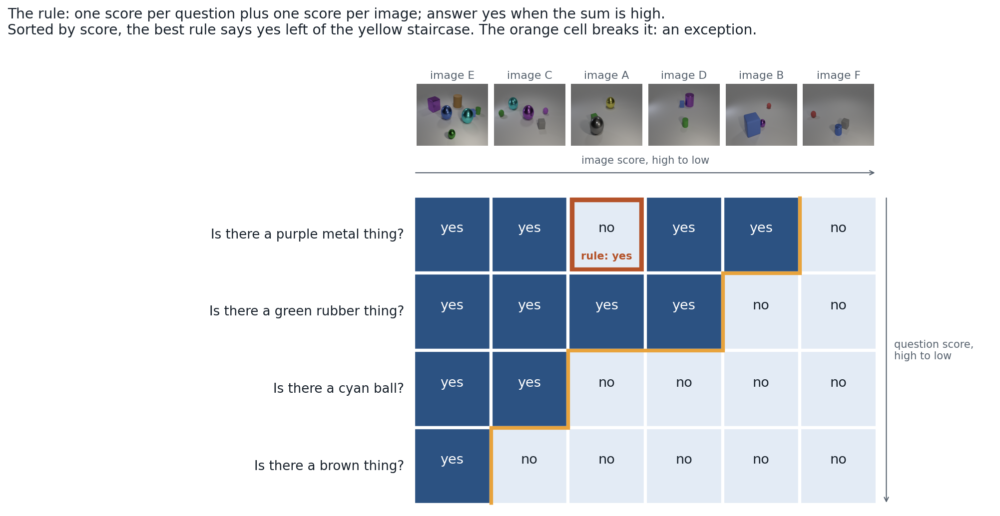

# What a Multimodal Model Must Fuse, and What Continual Learners Lose

**Diaa Abuhani, Amrin Kareem**

Code, pre-registrations, results and exported data for the paper.



## The idea in short

A multimodal yes/no task can be written as an **answer table** T(a, b): one row per question, one column per image.
The simplest multimodal model is **additive** (late fusion): each question gets a score u_a, each image a score v_b,
and the answer is `1[u_a + v_b > 0]`. The best such rule fits most cells. The cells it cannot fit are the
**exceptions**, and their share

```
s(T) = 1 − (accuracy of the best additive rule)
```

measures how much the task needs the two modalities to interact. We compute s exactly with a small mixed-integer
program (HiGHS, branch and bound), with no model training involved.

What s buys:

- **A floor.** If you remove a model's cross-modal interactions (EMAP), its accuracy drops by at least s minus its
  error.
- **Better than PID synergy.** Synergy depends only on the row and column answer counts, while s depends on how the
  answers are arranged. On controlled tasks s tracks how much fusion a model needs (partial ρ +0.91, versus +0.22 for
  synergy; replication +0.86 versus +0.11). On four zero-shot VLMs, with synergy, accuracy and yes-share all held
  fixed, s still predicts the EMAP drop (+0.26 to +0.43); synergy does not (+0.03 to +0.24).
- **Cell level.** A graded misfit score predicts which answers flip under EMAP (AUC 0.78–0.88), better than the model's
  own confidence.
- **Continual learning.** Across 12 continual-learning methods, exceptions are forgotten faster and learned worse than
  rule cells with the same answer and difficulty. Average accuracy and backward transfer hide this. On CLEVR, ER
  forgets exceptions 12.5 points more than matched rule cells. We report an exception accuracy (E-ACC) and an
  exception-aware replay buffer.

## Repository layout

```
code/      all scripts (Python and shell); code/xiu/ holds two adapters for the EMAP code of Xiu et al.
paper/     paper sources (LaTeX), pre-registrations, results text files, exported data
figures/   figures and the small CSVs they are drawn from; figures/revision/ holds the revised paper's figures
results/   small result tables from early exploratory runs
```

Scripts are in `code/` and grouped by name prefix. Paths below are relative to that folder for scripts, and to the
repository root for results.

| Part of the paper | Scripts | Results |
|---|---|---|
| Exact additive ceiling, s(T) | `exact_additive.py`, `additive_estimator.py`, `rev_unique.py` | `paper/results_estimator.txt`, `paper/results_rev_unique.txt` |
| PID measures (BROJA, I_ccs, MMI) | `pid_utils.py`, `liang_pid.py`, `liang_cvx.py`, `tables_pid*.py` | |
| Controlled tables and readout gap | `tables_build.py`, `tables_train*.py`, `tables_step1.py`, `run_step1.sh`, `run_step2.sh`, `v3_*.py`, `v4_*` | `paper/results_tables.txt`, `results_step*.txt`, `results_v3.txt`, `results_v4.txt` |
| Same-PID families | `samepid_build.py`, `analyze_samepid.py` | `paper/results_samepid.txt` |
| VLM answer tables (CLEVR, GQA, CLOVE, POPE) | `clevr_*.py`, `gqa_*.py`, `clove_*.py`, `pope_*.py`, `vlm_test.py` | `paper/results_vlm*.txt`, `results_pope.txt` |
| EMAP and the floor | `emap.py`, `xemap.py`, `analyze_emap.py` | `paper/results_emap.txt`, `results_xemap.txt` |
| VLM studies A, B, C | `vlm3_*.py`, `run_vlm3.sh`, `analyze_vlm3*.py` | `paper/results_vlm3*.txt` |
| Cell-level flips, graded misfit | `make_fig_flips.py`, `explore_graded.py` | `paper/revision/data/15*.csv` |
| Continual learning (12 methods) | `cl_seq*.py`, `cl_metrics*.py`, `cl_exceptions*.py`, `rps_core.py`, `run_clx.sh`, `run_clm*.sh` | `paper/results_clx.txt`, `results_clm.txt` |
| Difficulty matching | `cl_difficulty.py`, `analyze_difficulty.py`, `run_revision.sh` | `paper/results_rev_difficulty.txt` |
| Exception-aware buffer | `cl_bal.py`, `run_strat.sh` | `paper/results_strat.txt` |
| VLM continual learning (Qwen2.5-VL-3B, LoRA) | `vlm_seq*.py`, `run_clove_vlm.sh`, `run_nonce*.sh` | `paper/results_clove_vlm.txt`, `results_nonce_vlm.txt` |
| Tables and figures | `make_rev_data.py`, `make_rev_figs.py`, `make_fig_*.py`, `make_table.py` | `paper/revision/data/`, `figures/revision/` |

Other folders:

- `paper/revision/`: paper sections (LaTeX), supplement and bibliography.
- `paper/revision/data/`: CSV exports behind every table and figure, each described in its own
  [README](paper/revision/data/README.md). Start here if you only want the numbers.
- `paper/preregistration_*.md`: one pre-registration per study, written before the analysis was run. Each has a
  `.sha256` file holding the hashes of the scripts it used.
- `paper/findings_summary.md`: a running summary of the findings, including the tests that failed.

## Pre-registration

Every main study was pre-registered: its hypotheses, thresholds and analysis scripts were written down before the
numbers were computed. Each `paper/preregistration_*.sha256` file records the SHA-256 hashes of the pre-registration
and its scripts at the time it was fixed, with a timestamp. Many of these no longer match the current files, for
three reasons:

- results and addenda were later appended to the pre-registration documents;
- some shared scripts were extended for later studies;
- a few hashed files are third-party code that is not redistributed here.

The hashes therefore record the time each pre-registration was made. They do not check the current tree. We report
the tests that failed as well as the ones that passed (see `paper/revision/CHANGES.md` and
`paper/findings_summary.md`).

## Running the code

Requirements: Python 3.10+, PyTorch and a CUDA GPU for the training and VLM scripts.

```bash
pip install numpy scipy pandas scikit-learn matplotlib torch torchvision transformers peft qwen-vl-utils cvxpy dit pillow pyarrow
```

`scipy` ≥ 1.9 provides the HiGHS MILP solver used for s(T). `librosa` and `soundfile` are needed only for the
CREMA-D scripts.

Not included: raw datasets (CLEVR, GQA, CLOVE, POPE/COCO, CREMA-D), model weights and run outputs. The `*_build.py`
scripts rebuild the answer tables from the public datasets. VLM weights come from the Hugging Face Hub. Some
scripts contain absolute paths to local data folders; edit them to point at your copies.

Run everything from the repository root, for example `python code/analyze_vlm3.py`. Scripts read and write
`data/`, `runs/`, `paper/` and `figures/` relative to the root, whatever the working directory is. The `run_*.sh`
launchers expect a virtual environment at `.venv/` and set `CUDA_VISIBLE_DEVICES=2`; change both to match your
machine.

Typical order for one study: `code/*_build.py` (answer tables) → scoring or training (`code/run_*.sh`) →
`code/analyze_*.py` (pre-registered analysis).

## License

MIT; see [LICENSE](LICENSE). Datasets and model weights keep their own licenses.

## Citation

```bibtex
@misc{abuhani2026fuse,
  title  = {What a Multimodal Model Must Fuse, and What Continual Learners Lose},
  author = {Abuhani, Diaa and Kareem, Amrin},
  year   = {2026}
}
```
